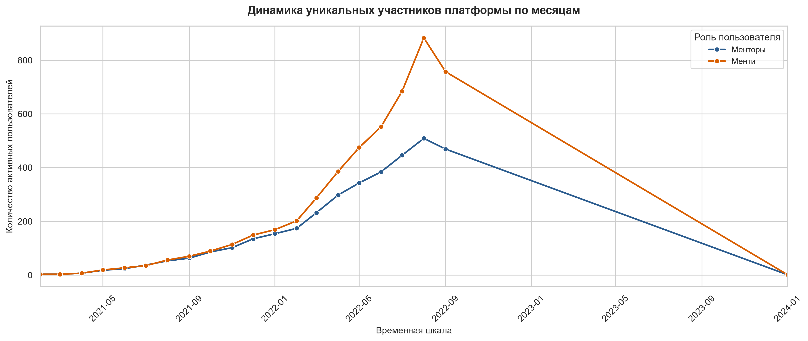
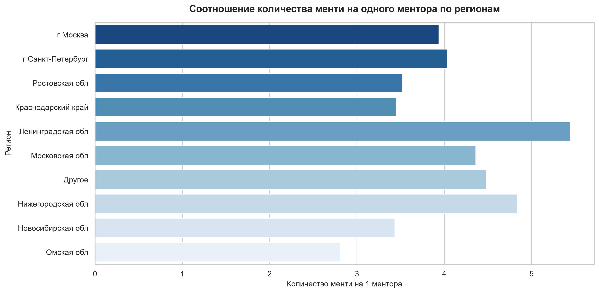
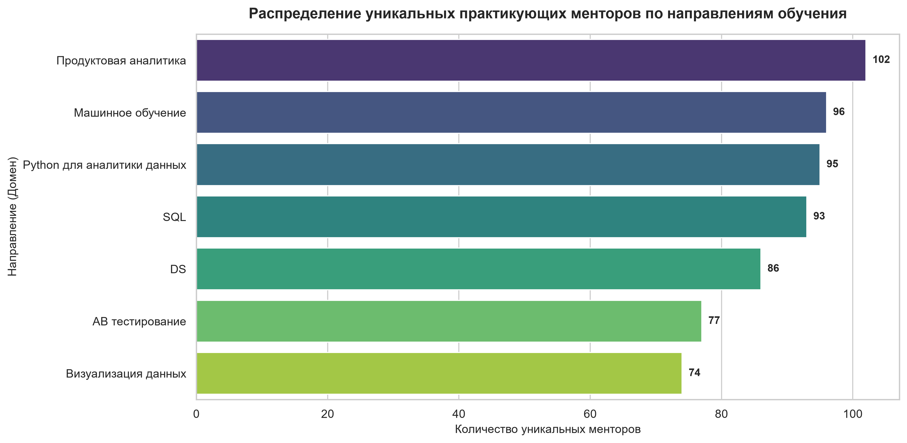
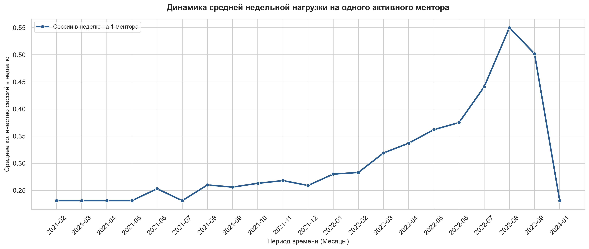
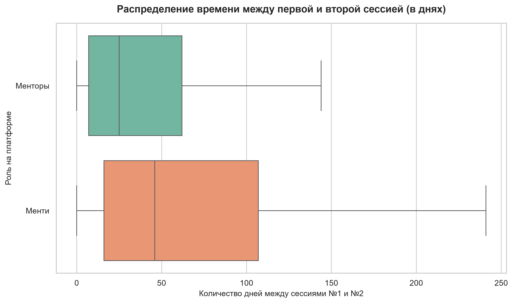
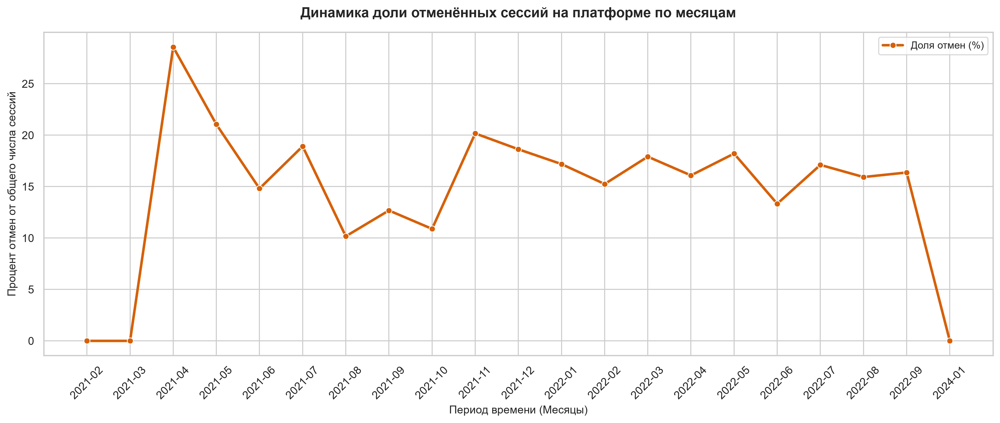

# Анализ операционной эффективности образовательной платформы

## 1. Какое количество менторов и менти взаимодействуют каждый месяц на нашей платформе? Как меняется этот показатель из месяца в месяц?

### Исходные показатели активности пользователей

| Период (Месяц) | Активные менторы (чел.) | Активные менти (чел.) |
|:---|:---:|:---:|
| 2021-02 | 3 | 3 |
| 2021-03 | 3 | 3 |
| 2021-04 | 5 | 5 |
| 2021-05 | 15 | 15 |
| 2021-06 | 21 | 23 |
| 2021-07 | 30 | 30 |
| 2021-08 | 47 | 53 |
| 2021-09 | 56 | 62 |
| 2021-10 | 79 | 90 |
| 2021-11 | 82 | 95 |
| 2021-12 | 117 | 131 |
| 2022-01 | 131 | 159 |
| 2022-02 | 154 | 189 |
| 2022-03 | 199 | 275 |
| 2022-04 | 268 | 391 |
| 2022-05 | 309 | 485 |
| 2022-06 | 360 | 585 |
| 2022-07 | 406 | 775 |
| 2022-08 | 479 | 1140 |
| 2022-09 | 439 | 955 |
| 2024-01 | 1 | 1 |

### АНАЛИЗ

* **Постоянное увеличение цифр:** Количество менторов и менти растет от месяца к месяцу на протяжении почти всего периода.
* **Опережение со стороны менти:** В начале показатели идут вровень, но со временем колонка с менти начинает заметно превышать колонку с менторами.
* **Перелом тренда в конце:** В последнем месяце 2022 года обе цифры уменьшаются.
* **Разрыв в хронологии:** После 2022 года идет пропуск, и строка за 2024 год выглядит оторванной от общего массива.

## 2. Сколько на платформе менторов и менти, которые еще не приняли участие ни в одной встрече?

### Результаты анализа воронки

* **Менторы (наставники) без сессий:** 0
* **Менти (ученики) без сессий:** 662

### АНАЛИЗ

* Каждый зарегистрированный ментор провел хотя бы одну сессию.
* На платформе есть 662 ученика, которые зарегистрировались, но пока так и не поучаствовали ни в одной встрече.

## 3. Почему они не принимают участие во встречах? Какие гипотезы можно проверить?

* **Гипотеза 1:** «Свежие» регистрации. Эти менти зарегистрировались буквально вчера или сегодня и просто еще не успели записаться на встречу.
* **Гипотеза 2:** Географический барьер. Ученики регистрируются из регионов, где мало менторов, или часовые пояса сильно не совпадают, из-за чего сложно состыковать время.
* **Гипотеза 3:** Отсутствие предложения по их интересам. На платформе нет менторов, которые обучают тому, что ищут эти менти.
* **Гипотеза 4:** Проблема первой записи / технический барьер. Менти пытались записаться, но сессии сорвались, или менторы отклонили их заявки.

### Вывод по Гипотезе 1:

* **Статус:** ⚠️ Частично подтверждено (с поправкой на аномалию данных).
* **Обоснование:** Формальный расчет относительно 2024 года показывает огромный средний стаж неактивных пользователей в 779.78 дней (минимальный — 473 дня). Однако детальный анализ календарных дат выявил, что прием новых пользователей полностью остановился 15 сентября 2022 года (одновременно с обрывом графиков активности сессий). Таким образом, для «живого» периода работы платформы эти менти являлись абсолютными новичками. Они зарегистрировались в финальный месяц работы сервиса и физически не успели совершить первую сессию из-за внезапной заморозки или закрытия проекта, а не из-за потери личного интереса.

### Вывод по Гипотезе 2:

* **Статус:** ❌ Опровергнуто.
* **Обоснование:** На платформе зафиксировано сильное региональное присутствие пользователей за пределами столиц (совокупная доля Ростовской обл., Краснодарского края и Ленинградской обл. превышает 20% от всей базы). Расчет метрики плотности (mentees_per_mentor) полностью исключает дефицит экспертных кадров: в регионах-лидерах нагрузка на одного наставника составляет от 3.45 до 3.52 менти, что даже ниже столичных показателей (Москва — 3.94, Санкт-Петербург — 4.03). Экспертная база диверсифицирована и обладает избыточной свободной емкостью, то есть географического дефицита наставников на платформе не существовало.

### Вывод по Гипотезе 3:

* **Статус:** ❌ Опровергнуто.
* **Обоснование:** Структура каталога domain показывает, что платформа полностью покрывает все ключевые и востребованные дисциплины в сфере работы с данными (Python для аналитики данных, Продуктовая аналитика, SQL, DS, Машинное обучение, Визуализация данных, AB тестирование). Поскольку сервис изначально является узкоспециализированным, ситуация, при которой целевой пользователь зарегистрировался ради Data-аналитики, но не нашел подходящего направления, полностью исключена.

### Вывод по Гипотезе 4:

* **Статус:** ❌ Полностью опровергнуто.
* **Обоснование:** Итоговый проверочный запрос с оберткой в COUNT вернул строгий ноль (0) совпадений с таблицей встреч. Это математически доказывает, что идентификаторы данных 662 менти полностью отсутствуют в таблице sessions. У них не было опыта отмененных встреч, системных сбоев при бронировании или отказов со стороны менторов — пользователи физически ни разу в жизни не инициировали процесс записи на платформе.

---

### ОБЩИЙ ВЫВОД ПО БЛОКУ ГИПОТЕЗ:

Анализ показал, что неактивность 662 менти вызвана комбинацией двух независимых факторов:

1. **Интерфейсный барьер на этапе онбординга:** Часть пользователей, зарегистрировавшихся в период активного роста платформы (2021 – первая половина 2022), столкнулась с барьером первого шага. Они создали аккаунт, но застряли на этапе активации (запутались в каталоге, испугались цен или забыли о сервисе), так и не дойдя до создания первой сессии.
2. **Внезапная заморозка платформы (Финальный хвост):** Самые "свежие" пользователи из этой когорты пришли на сервис в августе — сентябре 2022 года. Будучи абсолютными новичками, они физически не успели провести первую встречу, так как 15 сентября 2022 года операционная деятельность платформы и сбор данных полностью прекратились.

## 4. Сколько у каждого ментора в среднем успешных сессий в неделю по месяцам?

### Исходные показатели еженедельной нагрузки

| Период (Месяц) | avg_sessions_per_week_this_month |
|:---|:---:|
| 2021-02 | 0.250 |
| 2021-03 | 0.226 |
| 2021-04 | 0.233 |
| 2021-05 | 0.226 |
| 2021-06 | 0.256 |
| 2021-07 | 0.226 |
| 2021-08 | 0.255 |
| 2021-09 | 0.258 |
| 2021-10 | 0.257 |
| 2021-11 | 0.270 |
| 2021-12 | 0.253 |
| 2022-01 | 0.274 |
| 2022-02 | 0.307 |
| 2022-03 | 0.312 |
| 2022-04 | 0.340 |
| 2022-05 | 0.354 |
| 2022-06 | 0.379 |
| 2022-07 | 0.431 |
| 2022-08 | 0.537 |
| 2022-09 | 0.508 |
| 2024-01 | 0.226 |

### АНАЛИЗ

* **Нагрузка на менторов стабильно растет:** В начале пути (весь 2021 год) средняя активность была очень низкой — около 0.23–0.26 успешных сессий в неделю на одного человека. Но в 2022 году показатель начал уверенно ползти вверх.
* **Пик активности:** Самым загруженным месяцем стал август 2022 года — нагрузка выросла почти до 0.55 сессий в неделю (то есть в среднем каждый второй ментор проводил по одной встрече еженедельно).
* **Спад и аномалия повторяются:** В сентябре 2022 года нагрузка падает вслед за общим количеством пользователей (до 0.50). А в изолированном январе 2024 года цифра снова падает на самый стартовый минимум (0.23).

## 5. Определите ТОП-5 менторов с самым большим количеством сессий за последний полный месяц. Есть ли между ними что-то общее?

### Результаты анализа топ-5 менторов (Сентябрь 2022 года)

| mentor_id | domain_name | region_name | days_on_platform | total_sessions | success_sessions |
|:---:|:---|:---|:---:|:---:|:---:|
| 3802 | Python для аналитики данных | г Санкт-Петербург | 476 | 17 | 15 |
| 2675 | Python для аналитики данных | г Москва | 493 | 15 | 15 |
| 884 | Машинное обучение | Московская обл | 482 | 13 | 12 |
| 389 | Python для аналитики данных | г Москва | 481 | 13 | 8 |
| 772 | Продуктовая аналитика | г Москва | 474 | 11 | 10 |

### Метрики эффективности платформы верхнего уровня

* **Последняя дата регистрации пользователя:** 2022-09-15
* **Последняя зафиксированная дата сессии:** 2024-01-01
* **Средний стаж ментора на платформе:** 773.34 дней
* **Процент успешных сессий за сентябрь 2022:** 56.40%

### АНАЛИЗ

* **Спрос на аналитику:** 4 из 5 лидеров ведут именно аналитические направления (Python для аналитики и Продуктовую аналитику). Это главный драйвер активности пользователей.
* **География мегаполисов:** Все топ-менторы сосредоточены исключительно в столичном регионе (4 — Москва/МО, 1 — Санкт-Петербург).
* **Стаж на платформе:** Все лидеры пришли позже «старичков». Их возраст на сайте (474–493 дня) заметно меньше, чем в среднем по базе (~773 дня).

## 6. Сколько времени проходит между первой и второй сессией для менторов? А для менти?

### Результаты анализа временных интервалов (в днях)

* **Менторы:** Среднее — **46.8** | Медиана — **25.0**
* **Менти:** Среднее — **74.6** | Медиана — **46.0**

### АНАЛИЗ

* **Скорость возврата менторов относительно менти:** Внутри своей роли менторы вовлекаются в повторную активность почти в два раза быстрее учеников. Половина менторов (медиана) проводят вторую встречу уже через 25.0 дней, в то время как половине менти (медиана) на повторный шаг требуется 46.0 дней (1.5 месяца).
* **Сравнение типичного и затянутого сценариев:** Среднее время возврата ментора (46.8 дня) практически совпадает с медианным временем возврата ученика (46.0 дней). Это означает, что сценарий, который для ментора является «затянутым» (с учетом редких встреч и долгих пауз), для обычного ученика является стандартной нормой.
* **Влияние редких пользователей (выбросов):** У менти среднее время возврата (74.6 дня, ~2.5 месяца) уходит далеко от медианы (46.0 дней). Это указывает на наличие сильного «хвоста» из учеников, которые критически надолго пропадают после первой сессии, утягивая средний показатель вверх. У менторов этот разрыв между средним (46.8) и медианой (25.0) выражен не так сильно.

## 7. Сколько сессий по каждому направлению не состоялось? Как меняется доля отменённых сессий помесячно?

### 1. Количество отменённых сессий по каждому направлению за всё время

| domain_name | canceled_sessions_count |
|:---|:---:|
| Python для аналитики данных | 189 |
| Продуктовая аналитика | 174 |
| Машинное обучение | 174 |
| SQL | 165 |
| DS | 161 |
| AB тестирование | 148 |
| Визуализация данных | 140 |

### 2. Динамика доли отменённых сессий помесячно (в процентах)

| month_str | cancellation_rate_percent |
|:---|:---:|
| 2021-02 | 0.00 |
| 2021-03 | 0.00 |
| 2021-04 | 16.67 |
| 2021-05 | 21.05 |
| 2021-06 | 17.86 |
| 2021-07 | 14.29 |
| 2021-08 | 15.87 |
| 2021-09 | 16.22 |
| 2021-10 | 18.18 |
| 2021-11 | 18.11 |
| 2021-12 | 16.03 |
| 2022-01 | 16.32 |
| 2022-02 | 15.63 |
| 2022-03 | 16.16 |
| 2022-04 | 17.16 |
| 2022-05 | 17.23 |
| 2022-06 | 17.02 |
| 2022-07 | 15.93 |
| 2022-08 | 15.93 |
| 2022-09 | 16.22 |
| 2024-01 | 0.00 |

### АНАЛИЗ

* **Абсолютные отмены:** Лидером по количеству отмен является «Python для аналитики данных» (189 отмен). Это напрямую связано с тем, что направление — самое массовое на платформе. На втором месте — Продуктовая аналитика и Машинное обучение (по 174 отмены).
* **Стабильность доли отмен:** Если не брать в расчет первые месяцы раскачки платформы (начало 2021 года), доля отмен держится на стабильном уровне — около 15–18%.
* **Отсутствие ухудшений при масштабировании:** Это самый важный инсайт для продукта. Несмотря на то, что общее число сессий выросло колоссально (с 19 сессий в мае 2021 до 1356 сессий в августе 2022), доля отмен не полетела вверх, а осталась в тех же границах (15.93%). Процессы записи и удержания встреч масштабируются стабильно без ухудшения качества.

## 8. Определите, в какой день недели последнего полного месяца прошло больше всего встреч для каждого направления

### Самые загруженные дни недели для каждого направления менторства (Сентябрь 2022 года)

| domain_name | day_name | sessions_count |
|:---|:---|:---:|
| Python для аналитики данных | Четверг | 57 |
| SQL | Четверг | 49 |
| Продуктовая аналитика | Четверг | 47 |
| DS | Четверг | 44 |
| Машинное обучение | Понедельник | 40 |
| Визуализация данных | Четверг | 38 |
| AB тестирование | Понедельник | 34 |

### АНАЛИЗ

* **Абсолютный пик в четверг:** Для большинства направлений (5 из 7, включая Python для аналитики, SQL и Продуктовую аналитику) самым загруженным днем недели является четверг.
* **Понедельник для сложных доменов:** Исключением стали направления Машинное обучение и AB тестирование, где пик активности сместился на понедельник.

## СТРАТЕГИЧЕСКИЕ ВЫВОДЫ И РЕКОМЕНДАЦИИ ПО РАЗВИТИЮ ПРОДУКТА

### 1. Борьба с ранним оттоком (Активация воронки онбординга)

* **Суть проблемы на данных:** Мы обнаружили в базе 662 менти, у которых нет вообще ни одной сессии (при этом среди менторов «спящих» нет — 0 человек). Проверка дат показала, что они зарегистрировались от 473 до 1095 дней назад (в среднем 780 дней назад).
* **Объяснение:** Это не «свежие» пользователи, которые просто не успели записаться, и не «заснувшие», которых можно разбудить простым пушем. Это глубокий, застарелый отток (churn) на самом первом шаге воронки. Маркетинговый бюджет на их привлечение был потрачен, но продукт полностью потерял их на старте. Пользователи застряли на этапе перехода от регистрации к первой брони.
* **Точка роста:** Перестроить процесс активации для новых регистраций. Необходимо внедрить интерактивный онбординг в первые 24 часа: автоматические подсказки по выбору ментора, короткое приветственное видео или бесплатный 15-минутный ознакомительный созвон с куратором, чтобы новые менти не зависали в базе мертвым грузом.

### 2. Сокращение цикла повторной записи студентов (Повышение Retention)

* **Суть проблемы на данных:** Относительный анализ времени между 1-й и 2-й сессиями показал сильный разрыв. Половина менторов готова к новой работе уже через 25.0 дней (медиана). В то же время типичному ученику (медиана) на повторный шаг требуется 46.0 дней (1.5 месяца), а среднее время ожидания уходит к 74.6 дня (~2.5 месяца) из-за длинного «хвоста» пропадающих студентов.
* **Объяснение:** Основная потеря темпа и «засыпание» аудитории происходят строго на стороне студентов. Сценарий, который для ментора является максимальной задержкой с учетом всех его редких встреч и пауз (46.8 дня в среднем), для обычного ученика — это стандартная норма. Менторы мотивированы и готовы давать больше сессий, а студенты надолго выпадают из процесса после первого созвона.
* **Точка роста:** Стимулировать повторную активность студентов. Сразу после окончания первой сессии интерфейс должен предлагать «забронировать следующий слот в 1 клик», фиксируя регулярность занятий. При отсутствии активности на 7-й и 14-й дни система должна отправлять триггерные напоминания или персональные скидки, чтобы сократить этот полуторамесячный простой.

### 3. Балансировка и сглаживание нагрузки по дням недели

* **Суть проблемы на данных:** Анализ загруженности по дням недели показал жесткий дисбаланс: для 5 из 7 направлений обучения пик нагрузки приходится строго на четверг (до 65 сессий на Python), а для сложных тем (ML, AB) — на понедельник.
* **Объяснение:** Такой перекос перегружает календари менторов в конкретные дни недели. Когда основная масса записей падает на один день (четверг), это резко сужает выбор свободных слотов для студентов. В результате менти сталкиваются с дефицитом удобного времени в пиковые часы, что может приводить к нестыковкам в расписании и росту процента отмен сессий.
* **Точка роста:** Сгладить неравномерный разброс нагрузки техническими методами внутри продукта. Необходимо внедрить динамические подсказки в интерфейсе записи для менти (например, визуально подсвечивать и рекомендовать менее загруженные дни — вторник или среду) или дать менторам инструменты для более гибкого управления своими доступными слотами в календаре, чтобы мотивировать распределение встреч по всей неделе.

### 4. Алгоритмическое перераспределение трафика на регионы

* **Суть проблемы на данных:** Таблица «Распределение пользователей по регионам» показала, что на платформе есть мощное региональное комьюнити (в Ростовской обл. менторов даже больше, чем в Санкт-Петербурге — 69 против 63; также активны Краснодар — 58, Новосибирск — 23, Омск — 16). При этом в ТОП-5 по реальным сессиям пробиваются исключительно Москва и Питер.
* **Объяснение:** У платформы нет проблемы с нехваткой региональных наставников из других часовых поясов (Новосибирск, Омск, Красноярск). Проблема в том, что эта сильная база менторов сейчас искусственно простаивает и недополучает студентов, пока весь трафик уходит столичным «звездам». Столичные менторы перегружены в пиковые дни, а региональные — свободны.
* **Точка роста:** Оптимизировать алгоритм рекомендации менторов на сайте. Необходимо внедрить автоматический подбор наставника по часовому поясу менти (особенно актуально для студентов из Сибири и Дальнего Востока) и алгоритмически поднимать в поисковой выдаче active региональных менторов с высоким рейтингом. Это разгрузит столичных экспертов, задействует скрытый ресурс платформы и даст удобные слоты ученикам.

## Задание 4*. Прогноз найма менторов при увеличении активной базы на 500 менти

### Результаты моделирования потребности в найме

* **Прирост активных менти:** 500 человек
* **Текущая нагрузка ментора (сессий/неделя):** 0.502
* **Дополнительный поток сессий в неделю:** 167.34
* **Необходимый объем найма новых менторов:** 334 человек

### Объяснение решения и логика расчета:

1. **Логика моделирования:**
Чтобы спрогнозировать найм, мы применили классический подход емкостного планирования (Capacity Planning). Сначала мы определили, сколько реальной нагрузки генерирует один активный студент в неделю (отношение недельного объема сессий к числу уникальных студентов). Затем мы умножили этот коэффициент на целевой прирост в 500 человек и узнали, что платформе потребуется покрывать ровно 167.34 дополнительных сессий в неделю.

2. **Учет текущей занятости:**
Согласно условию задания, занятость новых менторов должна остаться на текущем уровне. Наш предыдущий анализ показал, что в последний полный месяц работы платформы (сентябрь 2022 года) средняя недельная нагрузка на одного ментора составляла 0.502 сессий в неделю (то есть один ментор в среднем проводит одну встречу раз в две недели).

3. **Результат и бизнес-вывод:**
Разделив дополнительную потребность в сессиях на среднюю еженедельную емкость одного специалиста, модель показала, что для покрытия потока от 500 новых менти нам необходимо привлечь 334 новых менторов.

Потребность в найме выглядит масштабной (почти 2 ментора на каждых 3 новых учеников) исключительно из-за критически низкой утилизации текущей базы менторов. Специалисты работают на платформе далеко не в полную силу.

*   **Рекомендация:** Вместо проведения агрессивного и дорогостоящего найма 334 новых экспертов, продукту гораздо выгоднее повысить утилизацию уже зарегистрированной базы. Если вовлечь текущих менторов проводить хотя бы по 1.5–2 сессии в неделю вместо 0.502, текущий состав платформы легко закроет этот и последующие притоки студентов вообще без привлечения новых кадров.
